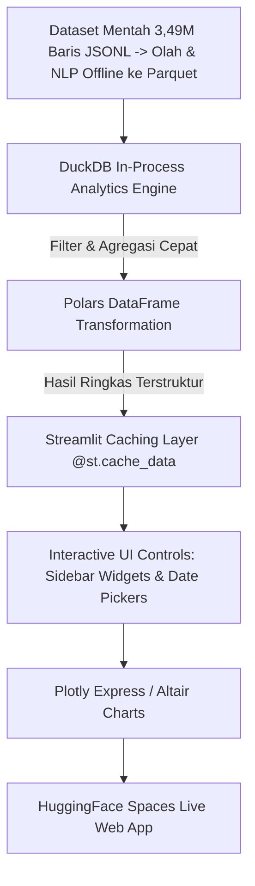

# Dokumen Arsitektur & Pitch Proposal Produk Data (Phase 1)

**Mata Kuliah:** Analisis Big Data  
**Target Check-in:** Pertemuan 10 (Diumumkan Pertemuan 8, repositori dibagikan Pertemuan 9)  
**Nama Tim:** AmazonRvw  
**Topik / Judul Produk Data:** Dashboard Analitik Kepuasan dan Sentimen Ulasan Produk Amazon (AmazonRvw)  

---

## 1. Problem Statement & Sasaran Pengguna (The Pitch)

### 1.1 Latar Belakang Masalah
Jumlah ulasan pembeli di platform e-commerce seperti Amazon sangat besar hingga mencapai jutaan baris dan terus bertambah setiap tahun. Ukuran data yang besar ini menyulitkan penjual maupun calon pembeli untuk memantau tren kepuasan pelanggan dari waktu ke waktu, membandingkan kualitas antar kategori produk, serta melihat lonjakan keluhan tanpa bantuan dashboard yang cepat dan interaktif.

### 1.2 Target Pengguna (Target Audience)
Pengguna utama produk data ini adalah penjual atau pemilik toko online yang ingin memantau performa produk dan keluhan pembeli, serta calon pembeli dan analis e-commerce yang ingin melihat tingkat kepuasan dan perbandingan ulasan pembeli asli (*verified purchase*) dengan yang bukan.

### 1.3 Nilai Tambah & Wawasan Utama
Setelah menggunakan dashboard ini, pengguna dapat melihat tren jumlah ulasan dan rata-rata rating antar tahun, mengetahui kategori produk dengan rating tertinggi maupun terendah, melihat perbandingan sentimen ulasan (positif, netral, negatif), serta mendeteksi periode dengan lonjakan ulasan yang tidak biasa.

---

## 2. Sumber Dataset & Skala Data

| Parameter | Keterangan |
|-----------|------------|
| **Nama Dataset** | Amazon Reviews 2023 — Gabungan 3 Kategori (`All_Beauty`, `Handmade_Products`, `Appliances`) |
| **Sumber Resmi** | https://huggingface.co/datasets/McAuley-Lab/Amazon-Reviews-2023 |
| **Format Awal** | `.jsonl` (dibersihkan dan diubah ke `.parquet` secara offline sebelum dipakai di dashboard) |
| **Ukuran Data** | **1.473,51 MB** (~1,44 GB) dan **3.494.295 baris** (`All_Beauty`: 701.528 baris / 311,48 MB; `Handmade_Products`: 664.162 baris / 275,64 MB; `Appliances`: 2.128.605 baris / 886,39 MB) |
| **Dimensi Waktu / Temporal** | **23 Oktober 2000 – 12 September 2023**, data dicatat per waktu ulasan (`timestamp` milidetik yang diubah ke tanggal harian) |
| **Fitur / Kolom Kunci** | `rating`, `title`, `text`, `asin`, `parent_asin`, `user_id`, `timestamp`, `helpful_vote`, `verified_purchase`, ditambah kolom hasil olahan offline `kategori`, `tanggal`, `sentimen`, dan `panjang_ulasan` (kolom `images` dihapus karena sebagian besar kosong) |

---

## 3. Diagram Arsitektur Data & Aliran Informasi

Gambarkan alur bagaimana data mengalir dari disk mentah hingga ke antarmuka pengguna:

---

## 4. Rencana Pemrosesan Data & Strategi Caching

### 4.1 Peran DuckDB (SQL Engine)
    DuckDB bertugas membaca dan meringkas data langsung dari file `.parquet` tanpa harus memuat 3,49 juta baris sekaligus ke RAM. Karena format Parquet tersusun per kolom, DuckDB hanya membaca kolom yang diperlukan untuk tiap grafik dan langsung menyaring data saat pembacaan.

Operasi analitik berat didelegasikan ke DuckDB diantaranya:
- **Penyaringan sesuai filter sidebar:** menyaring data berdasarkan `kategori`, rentang tahun dari kolom `tanggal`, status `verified_purchase`, dan label `sentimen`.
- **Perhitungan pada 4 metrik KPI:** menghitung total ulasan, rata-rata `rating`, persentase `verified_purchase`, dan total `helpful_vote` langsung menjadi satu baris ringkasan.
- **Agregasi grafik antar tab:** menghitung jumlah ulasan dan rata-rata `rating` per bulan dan per tahun, distribusi nilai `rating` 1–5, serta komposisi `sentimen` dan perbandingan rata-rata `rating` *verified* vs *non-verified* per kategori.
- **Statistik kuartil untuk Box Plot:** menghitung nilai minimum, kuartil bawah (Q1), median, kuartil atas (Q3), dan maksimum dari `panjang_ulasan` per kategori langsung di SQL (`QUANTILE_CONT`) agar Plotly tidak perlu memuat jutaan titik mentah ke browser.
- **Pembatasan cuplikan tabel:** mengambil maksimal 500 baris hasil filter menggunakan `LIMIT 500` langsung di kueri untuk tampilan tabel detail.

### 4.2 Peran Polars (Transformasi Data)
Polars tidak membaca file mentah, melainkan hanya menerima tabel hasil ringkasan dari DuckDB yang ukurannya sudah sangat kecil. Langkah ini menjaga penggunaan RAM tetap rendah sambil memanfaatkan sintaks Polars yang ringkas untuk proses analitik lanjutan diantaranya:
- **Tren rata-rata bergerak (*moving average*):** menghitung *rolling mean* dari jumlah ulasan dan rata-rata `rating` bulanan agar garis tren lebih halus dan mudah dibaca.
- **Deteksi lonjakan anomali (IQR):** menghitung batas atas dan batas bawah *Interquartile Range* (IQR) dari jumlah ulasan bulanan untuk menandai bulan-bulan dengan lonjakan ulasan yang tidak biasa.
- **Perhitungan persentase & penyiapan tabel:** menghitung persentase komposisi `sentimen` per kategori untuk grafik *stacked bar* serta merapikan tabel ringkasan bulanan agar siap diunduh sebagai file CSV.

### 4.3 Strategi Optimasi Memori & Caching Streamlit
Agar dashboard tetap ringan dan tidak melewati batas 16 GB RAM di HuggingFace Spaces, diterapkan dua metode berikut:
- **Caching hasil kueri dengan `@st.cache_data`:** setiap fungsi yang menjalankan query DuckDB dan olahan Polars dibungkus dengan `@st.cache_data` beserta batas `ttl` (masa simpan) dan `max_entries` (jumlah maksimal kombinasi filter yang disimpan). Saat pengguna berpindah tab tanpa mengubah filter atau kembali ke kombinasi filter yang sama, hasil langsung diambil dari cache tanpa menghitung ulang, sementara batas `max_entries` mencegah RAM penuh oleh tumpukan cache.
- **Tidak menyimpan data mentah di `st.session_state`:** dataset 3,49 juta baris tidak pernah dimuat penuh ke memori Python ataupun disimpan di `st.session_state`. Memori sesi Streamlit hanya menyimpan pilihan filter pengguna (kategori, rentang tahun, status verified, dan sentimen), sedangkan data yang masuk ke memori aplikasi hanyalah hasil agregasi kecil dan cuplikan maksimal 500 baris.

---

## 5. Rencana Tampilan Dashboard (Wireframe & Fitur UI)

Dashboard dibangun dengan Streamlit dan Plotly. Seluruh tampilan hanya membaca hasil olahan offline berformat Parquet melalui DuckDB, dengan kolom `kategori`, `tanggal`, `rating`, `sentimen`, `verified_purchase`, `panjang_ulasan`, dan `helpful_vote`.

1. **Header & Key Metrics KPI:**
   - 4 kartu metrik ringkasan yang mengikuti filter yang dipilih:
     1. **Total Ulasan** terfilter.
     2. **Rata-rata Rating** (skala 1-5).
     3. **Persentase Pembeli Asli**, yaitu ulasan dengan `verified_purchase` bernilai benar.
     4. **Total Klik Bermanfaat**, yaitu jumlah `helpful_vote`.
2. **Filter Interaktif (Sidebar):**
   - **Kategori produk** (pilih 1 sampai 3 dari `All_Beauty`, `Handmade_Products`, `Appliances`).
   - **Slider rentang tahun** (data tahun 2000-2023).
   - **Status pembeli asli** (semua, verified saja, atau non-verified saja).
   - **Sentimen** (positif, netral, negatif).
3. **Panel Visualisasi Utama (4 Tab):**
   - **Tab 1 — Tren Temporal:** Grafik garis jumlah ulasan atau rata-rata rating per bulan dari tahun ke tahun, dilengkapi garis rata-rata bergerak (*moving average*) dan range slider. Di bawahnya ada bar chart jumlah ulasan per tahun menurut kategori.
   - **Tab 2 — Distribusi & Anomali:** Bar chart sebaran nilai rating (1-5), box plot sebaran panjang ulasan per kategori, serta grafik jumlah ulasan bulanan dengan penanda lonjakan ulasan yang tidak biasa (pencilan metode IQR).
   - **Tab 3 — Perbandingan Kategori & Analisis Sentimen :**  perbandingan antar 3 kategori produk: komposisi sentimen positif/netral/negatif (stacked bar 100%), rata-rata rating per kategori, dan perbandingan rata-rata rating ulasan *verified* vs non-verified.
   - **Tab 4 — Tabel Data Detail:** Cuplikan tabel data hasil filter (500 baris) dengan tombol unduh ringkasan bulanan dalam format CSV.

---

## 6. Pembagian Tugas & Tanggung Jawab Anggota Tim

| Anggota Tim | Tanggung Jawab Utama di Phase 1 - 4 |
|-------------|-------------------------------------|
| Zaskia Nurismi Lingga | Desain arsitektur, data pipeline, dan integrasi Dockerfile |
| Faris Eka Iswanto | Penyusunan kueri analitik DuckDB dan optimasi partisi Parquet |
| Fany Fauzah | Desain antarmuka Streamlit, visualisasi Plotly, dan deployment ke HF Spaces |
